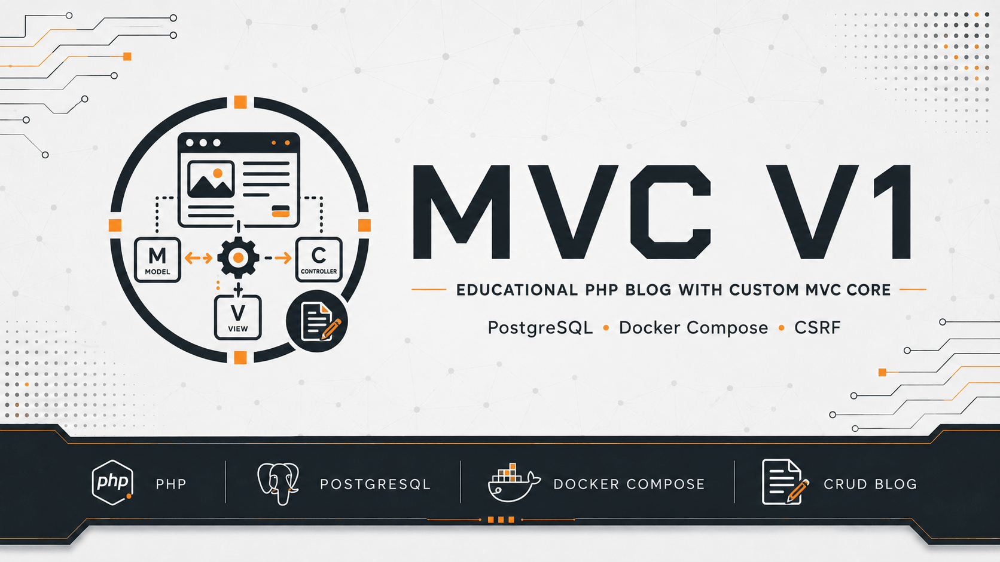
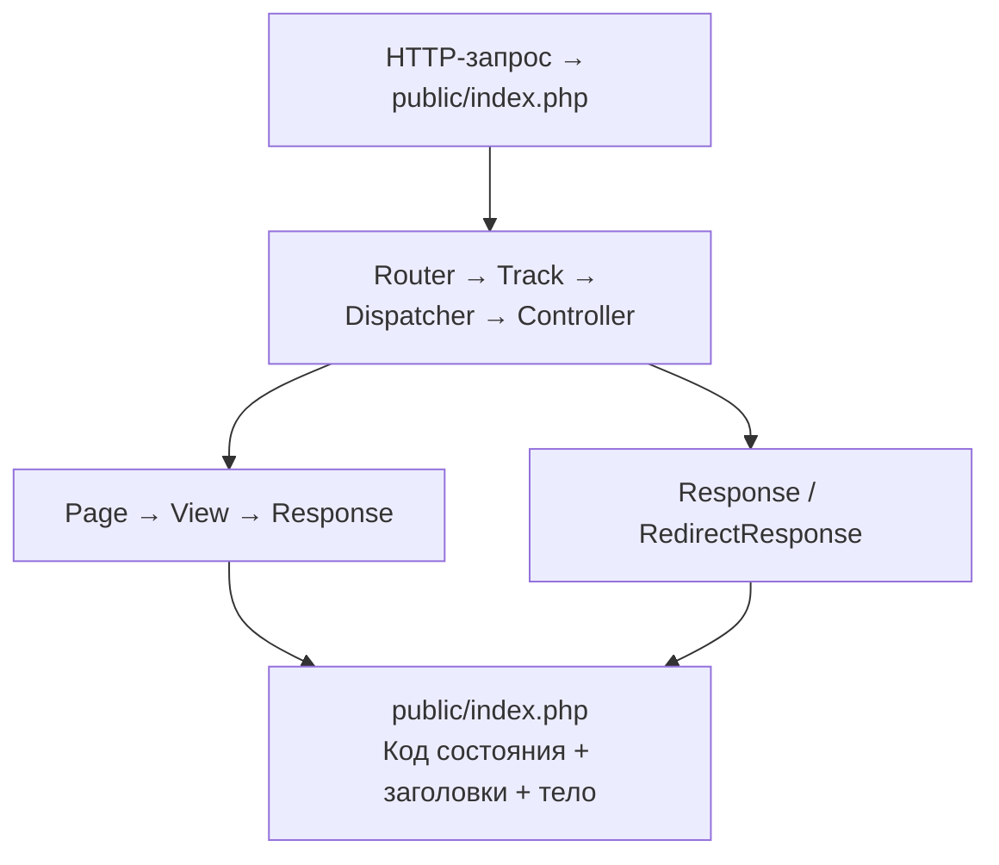

# MVC на PHP

## Выберите язык

| Русский | English | Español | 中文 | Français | Deutsch |
|---|---|---|---|---|---|
| **Выбран** | [English](docs/langs/en/README.md) | [Español](docs/langs/es/README.md) | [中文](docs/langs/zh/README.md) | [Français](docs/langs/fr/README.md) | [Deutsch](docs/langs/de/README.md) |

Это один из моих первых проектов с самостоятельной реализацией MVC без готового фреймворка. В качестве примера используется простой блог со статьями: маршрутизация, контроллеры, модели, представления и CRUD собраны так, чтобы весь путь запроса можно было проследить по собственному коду.

Проект сознательно не превращён в конструктор из готовых библиотек. PostgreSQL используется напрямую через PDO, без ORM. В рабочем коде нет сторонних PHP-библиотек: собственное MVC-ядро подключается как локальный Composer-пакет `yaa/mvc-framework`, а приложение опирается на PHP и обязательные расширения `mbstring`, `PDO` и `pdo_pgsql`.

> [!NOTE]
> **UPD 2026.** Исходная идея не изменилась: это всё тот же небольшой MVC-проект, но уже приведённый в порядок под PHP 8.5, актуальные PostgreSQL и Bootstrap и более безопасную обработку изменяющих запросов. Docker Compose даёт воспроизводимый локальный запуск без установки PHP и Composer на хост, при этом возможность ручной настройки без Docker сохранена.

## Возможности

- создание, просмотр, редактирование и удаление статей;
- PostgreSQL через PDO и параметризованные запросы;
- пагинация списка статей;
- серверная валидация с сохранением введённых значений при ошибках;
- CSRF-защита изменяющих запросов;
- сообщения после CRUD-операций;
- экранирование динамического вывода;
- типизированные `Page`, `Response` и `RedirectResponse`;
- Docker Compose с Nginx, PHP-FPM и PostgreSQL;

## Быстрый старт

Понадобятся Git, Make и Docker с поддержкой Compose.

| Команда | Что делает | Примечание |
|---|---|---|
| `git clone https://github.com/yaleksandr89/mvc-v1.git` | Клонирует репозиторий | |
| `cd mvc-v1` | Переходит в каталог проекта | |
| `make init` | Создаёт `.env.docker` и рабочие каталоги | Обычно выполняется один раз после клонирования |
| `make build` | Собирает Docker-образ PHP | |
| `make up` | Запускает Nginx, PHP-FPM и PostgreSQL | |
| `make composer-install` | Устанавливает зависимости из `composer.lock` | PHP и Composer на хосте не нужны |
| `make demo-data` | Загружает 50 демонстрационных статей | Только в пустую таблицу `blog_posts` |
| `make down` | Останавливает окружение | Данные PostgreSQL сохраняются |

После запуска приложение доступно по адресу [http://localhost:8080](http://localhost:8080).

> [!IMPORTANT]
> `make demo-data` работает только с пустой таблицей `blog_posts`: если в ней уже есть данные, команда остановится и ничего не перезапишет. Полностью пересоздать локальную PostgreSQL и сразу загрузить демонстрационные данные можно командой `make postgres-reinit CONFIRM=postgres18 WITH_DEMO_DATA=1`; она удаляет локальный том PostgreSQL.

Подробности об окружении, тестовой базе, остальных командах и ручном запуске без Docker собраны в [руководстве по разработке](docs/langs/ru/development.md).

## Как устроено приложение

`Page` описывает страницу, которую ещё нужно отрендерить, а `Response` и `RedirectResponse` представляют уже готовые HTTP-ответы. Код состояния, заголовки и тело отправляются только во входном скрипте `public/index.php`.

Модель статей работает с PostgreSQL напрямую через PDO. Реальные ошибки остаются исключениями внутри приложения, записываются в журнал на своём уровне и преобразуются в безопасный ответ `500` без вывода технических деталей пользователю.

Маршрутизация, границы ответственности и полный путь запроса подробно разобраны в [описании архитектуры](docs/langs/ru/architecture.md).

## Проверки и покрытие

| Команда | Что делает | Примечание |
|---|---|---|
| `make test` | Запускает PHPUnit | Перед запуском сбрасывается отдельная тестовая база |
| `make test-dox` | Запускает PHPUnit с читаемыми названиями сценариев | |
| `make cs-check` | Проверяет стиль PHP | Показывает diff при нарушениях; не изменяет исходники |
| `make cs-fix` | Форматирует PHP-код | Изменяет исходники; не сбрасывает тестовую базу |
| `make check` | Проверяет Composer, зависимости, стиль PHP через PHP CS Fixer, PHPStan и PHPUnit | Основная комплексная проверка; перед запуском сбрасывает тестовую базу |
| `make coverage` | Показывает покрытие и создаёт Clover XML | Результат: `runtime/coverage.xml` |
| `make coverage-html` | Создаёт HTML-отчёт покрытия | Результат: `runtime/coverage/index.html` |
| `make smoke` | Проверяет приложение через настоящий HTTP-запрос | Нужны 50 демонстрационных статей |

Тесты используют отдельную базу `mvc_v1_test`, поэтому основная база разработки при их запуске не затрагивается.

Полный список команд Make и устройство CI приведены в [руководстве по разработке](docs/langs/ru/development.md).

## Что намеренно оставлено простым

- MVC-ядро остаётся небольшим, чтобы основной путь запроса можно было проследить непосредственно по коду;
- отдельный контейнер зависимостей не добавлен;
- ORM и дополнительный слой репозиториев не добавлены, работа с PostgreSQL идёт через PDO;
- отдельная цепочка промежуточных обработчиков и система событий не вводились;

Более подробно эти решения и границы ответственности описаны в [документе об архитектуре](docs/langs/ru/architecture.md).

## Обратная связь

- воспроизводимые ошибки — [GitHub Issues](https://github.com/yaleksandr89/mvc-v1/issues);
- вопросы и идеи — [GitHub Discussions](https://github.com/yaleksandr89/mvc-v1/discussions).

---

  Если проект оказался полезен, поставьте звезду на GitHub — так его будет проще найти другим разработчикам. 🤘

